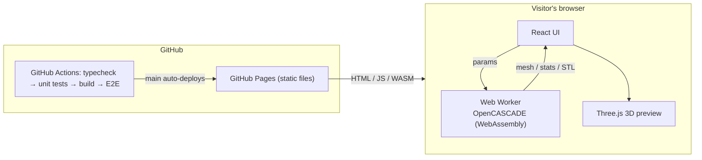

<div align="center">

# 🗃️ BoxForge

**Parametric 3D storage-box generator — rounded corners, recursive dividers, support-free 45° pill vents, straight to a printable STL. Runs entirely in your browser.**

### 👉 [Use it online: owenwoow.github.io/BoxForge](https://owenwoow.github.io/BoxForge/)

[](https://github.com/Owenwoow/BoxForge/actions/workflows/ci-cd.yml)
[](LICENSE)


**English** · [简体中文](README.zh-CN.md)

</div>

---

## Table of contents

- [What is this?](#what-is-this)
- [Features](#features)
- [How to use it](#how-to-use-it)
- [Architecture](#architecture)
- [Local development](#local-development)
- [Documentation](#documentation)
- [Project structure](#project-structure)
- [Contributing](#contributing)
- [License](#license)

## What is this?

BoxForge turns a handful of parameters into a custom storage box and exports a **3D-printable STL**. Set the size, round the corners, drop in dividers wherever you want, punch support-free vents into the floor and dividers, then download and print.

Geometry is built with [OpenCASCADE](https://dev.opencascade.org/) — a real B-rep CAD kernel, **not** a mesh library — compiled to WebAssembly and running right in your browser. Fillets, shells and booleans are robust, and there is **no server: nothing is uploaded**.

> Boxes are **open-topped (no lid)** by design. Length and width are hard-capped at **250 mm** to fit a 256×256 print bed.

## Features

- **Custom dimensions** — length / width / height / wall thickness, via slider or exact number.
- **Two independent fillet types** — vertical corner radius (phone-case style) *and* top/bottom rim fillets (no sharp edges). The top rim rounds **both** the outer and inner lip.
- **Recursive dividers (BSP tree)** — split any region along length or width; each resulting cell can be subdivided again on its own. One-click presets (halves, cross) and a live top view.
- **45° support-free pill vents** — staggered capsule holes in the floor and/or dividers, auto-spaced with a solid border frame. Outer walls are never vented.
- **Live 3D preview** — the model sits on a simulated 256×256 bed (Bambu Studio-style); modeling runs in a background thread, so dragging sliders never freezes the page.
- **Import, export and share configs** — download the design as YAML, import YAML to restore it, or copy a share link that encodes the whole design in the URL.
- **Bilingual (中文 / English) + light/dark theme**, works on phones.
- **Hardened input** — geometry limits are clamped (with a notice), filenames sanitized, divider-tree depth/size capped.

## How to use it

1. Open **<https://owenwoow.github.io/BoxForge/>** (the first visit downloads the ~7 MB CAD kernel; later visits use the browser cache).
2. Tune the parameters on the left; the 3D preview on the right updates live.
3. Once **Valid geometry** shows `OK`, click **Download STL** and drop it into your slicer.

Every parameter, its limits, and common issues are covered in the [Usage reference](docs/usage.md).

## Architecture

The project is designed to be **built, tested and hosted on GitHub** — no servers anywhere:



- **Fully static site** — modeling happens in the visitor's browser; GitHub Pages only serves HTML/JS/WASM.
- **All CI/CD on GitHub Actions** — every PR must pass typecheck, unit tests, the build, and a real-browser E2E run before it can merge into `main`; merging deploys to Pages automatically. Pushing a `vX.Y.Z` tag publishes a Release with the built site attached as a zip.
- **Modeling core separate from the UI** — `src/core/` is DOM-free TypeScript tested in Node; the geometry tests pin volumes produced by the original Python/CadQuery implementation, so the port stays exact.

> The previous version (Python + CadQuery + Streamlit, with CLI and desktop app) is preserved on the [`legacy`](https://github.com/Owenwoow/BoxForge/tree/legacy) branch.

## Local development

Requires Node.js 22 or newer.

```bash
git clone https://github.com/Owenwoow/BoxForge.git
cd BoxForge
npm install

npm run dev         # dev server with hot reload  -> http://localhost:5173
npm test            # unit tests: config validation + real OpenCASCADE modeling
npm run build       # production build into dist/
npm run e2e         # end-to-end tests in Chromium (run `npx playwright install chromium` first)
```

Branch model, commit conventions and release steps: [CONTRIBUTING.md](CONTRIBUTING.md).

## Documentation

| Guide | English | 简体中文 |
|---|---|---|
| Parameters & usage reference | [usage.md](docs/usage.md) | [usage.zh-CN.md](docs/usage.zh-CN.md) |
| Development, CI/CD & releases | [CONTRIBUTING.md](CONTRIBUTING.md) | same file (bilingual) |

## Project structure

```
BoxForge/
├── src/
│   ├── core/                  # DOM-free TypeScript, tested in Node
│   │   ├── config.ts           # config schema, validation + safe clamping, presets
│   │   └── geometry/
│   │       ├── oc.ts           # OpenCASCADE (WASM) setup
│   │       ├── body.ts         # box body: fillets + shell
│   │       ├── partitions.ts   # recursive BSP dividers
│   │       ├── hollow.ts       # 45° pill-vent arrays
│   │       └── build.ts        # assembly, stats, preview mesh, STL export
│   ├── worker/                # background modeling thread (Web Worker)
│   └── ui/                    # React UI, Three.js preview, zh/en strings
├── e2e/                       # Playwright end-to-end tests
├── docs/                      # usage reference (English + 简体中文)
├── index.html · vite.config.ts · playwright.config.ts
└── .github/workflows/         # ci-cd.yml (test + deploy Pages) · release.yml
```

## Contributing

Contributions are welcome! See [CONTRIBUTING.md](CONTRIBUTING.md) for the dev setup, branch model (`dev` for work, `main` = what's live), and commit conventions. Open an [issue](https://github.com/Owenwoow/BoxForge/issues) for bugs and feature requests.

## License

Released under the [MIT License](LICENSE). The modeling kernel uses [replicad](https://replicad.xyz/) (MIT) and `replicad-opencascadejs`, a WebAssembly build of OpenCASCADE (LGPL-2.1), shipped as a separate `.wasm` file with the site.
