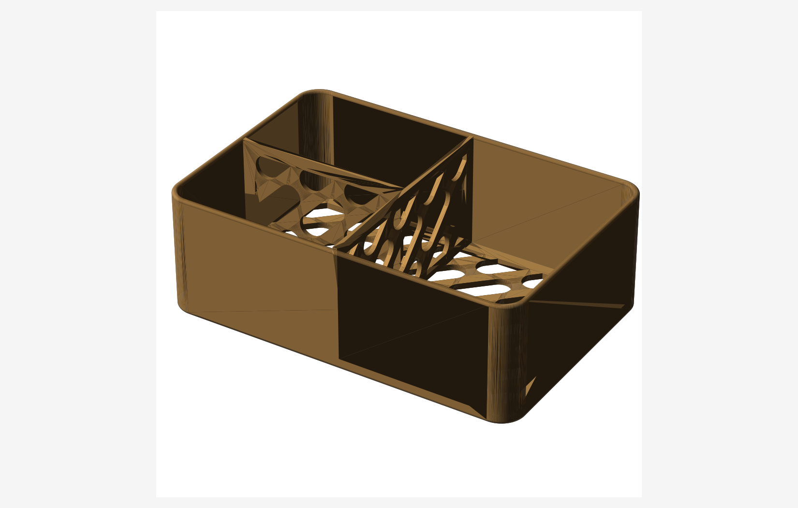

<div align="center">

# 🗃️ BoxForge

**参数化 3D 收纳盒生成器 —— 圆角、递归隔板、45° 免支撑药丸镂空，一键导出可打印 STL。**

[](https://github.com/Owenwoow/BoxForge/actions/workflows/ci.yml)
[](https://github.com/Owenwoow/BoxForge/actions/workflows/build-desktop.yml)
[](https://github.com/Owenwoow/BoxForge/releases/latest)
[](LICENSE)
[](https://www.python.org/)



[English](README.md) · **简体中文**

</div>

---

## 目录

- [这是什么？](#这是什么)
- [功能特性](#功能特性)
- [界面截图](#界面截图)
- [快速开始](#快速开始)
  - [方式一 —— 桌面版（无需 Python）](#方式一--桌面版无需-python)
  - [方式二 —— 从源码运行](#方式二--从源码运行)
  - [方式三 —— Docker（公网部署）](#方式三--docker公网部署)
- [文档](#文档)
- [项目结构](#项目结构)
- [参与贡献](#参与贡献)
- [开源协议](#开源协议)

## 这是什么？

BoxForge 把几个参数变成一个定制收纳盒，并导出**可 3D 打印的 STL**。填好尺寸、把四角磨圆、在任意位置加隔板、在底面和隔板上打免支撑透气孔，然后下载打印即可。

它提供两种形态，共用同一套建模引擎：

| 方式 | 适合场景 | 入口 |
|---|---|---|
| **网页界面**（Streamlit） | 手动调参 + 实时 3D 预览 | `streamlit run box_generator/app.py` |
| **命令行** | 写脚本、批量生成、自动化 | `python box_generator/main.py config.yaml` |

几何建模基于 [CadQuery](https://github.com/CadQuery/cadquery) —— 真正的 OpenCASCADE B-rep CAD 内核，**不是** mesh 网格库 —— 所以圆角、抽壳、布尔运算都稳健可靠。

> 收纳盒设计为**顶面开口无盖**。长宽硬性上限 **250 mm**，适配 256×256 打印板。

## 功能特性

- **自定义尺寸** —— 长 / 宽 / 高 / 壁厚全部参数化。
- **两类独立圆角** —— 竖直四角圆角（手机壳那种）*和* 顶/底水平棱圆角（不割手）。顶沿会**同时**倒内外两条棱。
- **递归隔板（BSP 树）** —— 沿 X 或 Y 切分任意区域，切完的每个子区域还能独立继续细分。对半分、十字四格等预设一键生成。
- **45° 免支撑药丸镂空** —— 底面和/或隔板上的交错胶囊孔，自动排布并保留一圈实心边框。45° 角能自架桥，无需支撑即可打印。外墙永不镂空。
- **实时 3D 预览** —— 网页界面把模型放在模拟的 256×256 打印板上（仿 Bambu Studio），可在浏览器里旋转缩放。
- **中英双语 + 明暗主题** —— 中文 / English、亮色 / 暗色都能随时切换。
- **输入加固** —— 几何上限自动钳制、文件名净化、隔板树深度/数量有上限，可安全地部署到公网。

## 界面截图

> 📌 **在这里放你自己的界面截图。** 运行网页界面，对整窗截图，保存到下面的路径，然后取消对应行的注释即可。

<!--  -->
`docs/images/ui_overview.png` *(待补 —— 建议约 1200px 宽)*

## 快速开始

### 方式一 —— 桌面版（无需 Python）

对非开发者最简单。从 [**最新 Release**](https://github.com/Owenwoow/BoxForge/releases/latest) 下载对应系统的预编译版，解压后运行 `BoxForge`——它会自动启动本地服务并在浏览器打开网页界面。不需要 Python、不需要 `pip`。

| 平台 | 下载 |
|---|---|
| Windows x64 | `BoxForge-windows-x64.zip` |
| Linux amd64 | `BoxForge-linux-amd64.tar.gz` |
| macOS（Apple 芯片） | `BoxForge-macos-arm64.tar.gz` |

> Intel 芯片 Mac：请 [从源码运行](#方式二--从源码运行) 或用 [Docker](#方式三--docker公网部署)。

运行方法和系统安全提示见 [桌面版指南](docs/desktop-app.zh-CN.md)。

### 方式二 —— 从源码运行

```bash
# 需要 Python 3.11–3.14
git clone https://github.com/Owenwoow/BoxForge.git
cd BoxForge

python -m venv .venv
# Windows PowerShell：  .venv\Scripts\Activate.ps1
# macOS / Linux：       source .venv/bin/activate
pip install -r requirements.txt

# 网页界面  ->  http://localhost:8501
streamlit run box_generator/app.py

# …或走命令行
python box_generator/main.py box_generator/config.yaml   # 生成 box_output.stl
```

完整步骤见 [安装教程](docs/installation.zh-CN.md)。

### 方式三 —— Docker（公网部署）

在服务器上把网页界面部署给别人用：

```bash
docker run -d -p 8501:8501 ghcr.io/owenwoow/boxforge:latest
# 或带上仓库自带的资源上限：  docker compose pull && docker compose up -d
# -> 网页界面在 http://<服务器IP>:8501
```

镜像由 GitHub Actions 在每次发版时自动构建、测试并发布到 GHCR，服务器上不需要再构建。镜像已做公网加固（非 root、资源上限、缓存有界、输入滥用防护）。请在 `8501` 端口前挂一个终结 HTTPS 的反向代理。完整指南见 [部署教程](docs/deployment.zh-CN.md)。

## 文档

| 指南 | English | 简体中文 |
|---|---|---|
| 安装与从源码运行 | [installation.md](docs/installation.md) | [installation.zh-CN.md](docs/installation.zh-CN.md) |
| 桌面版（预编译） | [desktop-app.md](docs/desktop-app.md) | [desktop-app.zh-CN.md](docs/desktop-app.zh-CN.md) |
| 参数与使用手册 | [usage.md](docs/usage.md) | [usage.zh-CN.md](docs/usage.zh-CN.md) |
| 公网部署（Docker） | [deployment.md](docs/deployment.md) | [deployment.zh-CN.md](docs/deployment.zh-CN.md) |

## 项目结构

```
BoxForge/
├── box_generator/
│   ├── config.yaml            # 命令行用的样例配置
│   ├── main.py                # 命令行入口
│   ├── app.py                 # Streamlit 网页界面入口
│   ├── desktop_app.py         # 桌面版启动器（由 PyInstaller 打包）
│   ├── .streamlit/            # Streamlit 配置（公网部署加固）
│   └── box_builder/
│       ├── validate.py         # YAML 校验 + 安全钳制
│       ├── body.py             # 盒体：圆角 + 抽壳
│       ├── partitions.py       # 递归 BSP 隔板
│       ├── hollow.py           # 45° 药丸镂空阵列
│       └── export.py           # STL 导出
├── tests/                     # pytest 测试（校验、建模、网页界面）
├── packaging/                 # PyInstaller 打包脚本 + 冒烟测试
├── docs/                      # 教程（English + 简体中文）
├── Dockerfile · docker-compose.yml
└── .github/workflows/         # CI/CD：测试、Docker 镜像、桌面版发布
```

## 参与贡献

欢迎贡献！开发环境、分支模型（`dev` 用于开发，`main` 只放正式版本）、提交规范请见 [CONTRIBUTING.md](CONTRIBUTING.md)。Bug 和需求请提 [issue](https://github.com/Owenwoow/BoxForge/issues)。

## 开源协议

基于 [MIT 协议](LICENSE) 发布。
