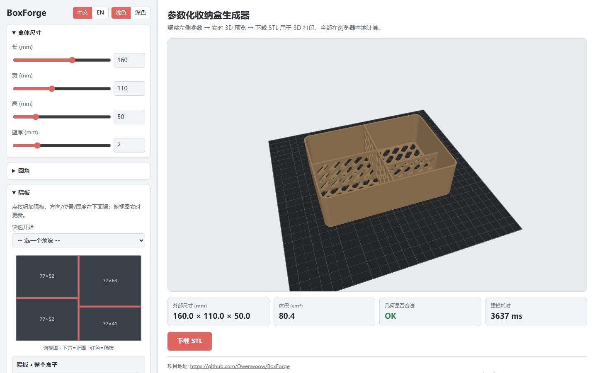
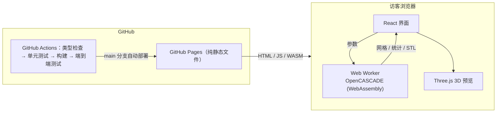

<div align="center">

# 🗃️ BoxForge

**参数化 3D 收纳盒生成器 —— 圆角、递归隔板、45° 免支撑药丸镂空，一键导出可打印 STL。打开网页就能用，全部在浏览器本地计算。**

### 👉 [在线使用：owenwoow.github.io/BoxForge](https://owenwoow.github.io/BoxForge/)

[](https://github.com/Owenwoow/BoxForge/actions/workflows/ci-cd.yml)
[](https://github.com/Owenwoow/BoxForge/releases/latest)
[](LICENSE)


[English](README.md) · **简体中文**

</div>

---

## 目录

- [这是什么？](#这是什么)
- [功能特性](#功能特性)
- [界面截图](#界面截图)
- [怎么用](#怎么用)
- [自行部署](#自行部署)
- [架构](#架构)
- [本地开发](#本地开发)
- [文档](#文档)
- [项目结构](#项目结构)
- [参与贡献](#参与贡献)
- [开源协议](#开源协议)

## 这是什么？

BoxForge 把几个参数变成一个定制收纳盒，并导出**可 3D 打印的 STL**。填好尺寸、把四角磨圆、在任意位置加隔板、在底面和隔板上打免支撑透气孔，然后下载打印即可。

几何建模用的是 [OpenCASCADE](https://dev.opencascade.org/) —— 真正的 B-rep CAD 内核（**不是** mesh 网格库），编译成 WebAssembly 后直接在你的浏览器里运行，所以圆角、抽壳、布尔运算都稳健可靠，而且**没有服务器、不上传任何数据**。

> 收纳盒设计为**顶面开口无盖**。长宽硬性上限 **250 mm**，适配 256×256 打印板。

## 功能特性

- **自定义尺寸** —— 长 / 宽 / 高 / 壁厚全部参数化，滑块和数值框都能调。
- **两类独立圆角** —— 竖直四角圆角（手机壳那种）*和* 顶/底水平棱圆角（不割手）。顶沿会**同时**倒内外两条棱。
- **递归隔板（BSP 树）** —— 沿长或宽切分任意区域，切完的每个子区域还能独立继续细分；对半分、十字四格等预设一键生成，俯视图实时显示。
- **45° 免支撑药丸镂空** —— 底面和/或隔板上的交错胶囊孔，自动排布并保留一圈实心边框。外墙永不镂空。
- **实时 3D 预览** —— 模型放在模拟的 256×256 打印板上（仿 Bambu Studio），可旋转缩放；建模在后台线程进行，拖滑块不卡页面。
- **配置可导入导出、可分享** —— 当前设计可下载为 YAML，也可导入 YAML 还原；「复制分享链接」把整份设计编码进网址，对方打开就是同一个盒子。
- **中英双语 + 明暗主题**，手机上也能用。
- **输入加固** —— 几何上限自动钳制（并提示）、文件名净化、隔板树深度/数量有上限。

## 界面截图



## 怎么用

1. 打开 **<https://owenwoow.github.io/BoxForge/>**（首次需下载约 7 MB 的 CAD 内核，之后走浏览器缓存）。
2. 在左侧调参数，右侧 3D 预览实时更新。
3. 统计信息里「几何是否合法」显示 `OK` 后，点 **下载 STL**，拖进切片软件打印。

每个参数的含义、取值范围和常见问题见 [使用手册](docs/usage.zh-CN.md)。

## 自行部署

BoxForge 是纯静态网站，不需要任何后端：

- **Fork 后用自己的 GitHub Pages**：Fork 仓库 → Settings → Pages → Source 选 **GitHub Actions** → 推送到 `main`，`ci-cd.yml` 会自动测试并发布到 `https://<你的用户名>.github.io/BoxForge/`。
- **放到任意静态主机**：从 [Releases](https://github.com/Owenwoow/BoxForge/releases/latest) 下载 `boxforge-site-vX.Y.Z.zip`，解压到 Nginx / Caddy / 对象存储等任意静态文件服务即可。站点使用相对路径，放在根路径或子路径都能用；服务器需能以 `application/wasm` 类型返回 `.wasm` 文件（主流服务器默认支持）。

## 架构

整个项目按「**在 GitHub 上构建、测试、托管**」来设计，不需要任何服务器：



- **纯静态站点**：建模在访客浏览器里完成，GitHub Pages 只负责分发 HTML/JS/WASM 文件。
- **CI/CD 全在 GitHub Actions**：每个 PR 都要通过类型检查、单元测试、构建和真实浏览器端到端测试才能合入 `main`；合入后自动发布到 Pages。打 `vX.Y.Z` 标签会生成 Release，并附带打包好的站点 zip。
- **建模核心与界面分离**：`src/core/` 是不依赖 DOM 的纯 TypeScript，在 Node 里就能测试；单元测试用旧版 Python/CadQuery 实现算出的体积做基准，保证移植后的几何结果一致。

> 旧版（Python + CadQuery + Streamlit，含命令行与桌面版）完整保存在 [`legacy`](https://github.com/Owenwoow/BoxForge/tree/legacy) 分支；其桌面版安装包见 [v0.1.0 Release](https://github.com/Owenwoow/BoxForge/releases/tag/v0.1.0)。从 v0.2.0 起为浏览器版。

## 本地开发

需要 Node.js 22 或更新版本。

```bash
git clone https://github.com/Owenwoow/BoxForge.git
cd BoxForge
npm install

npm run dev         # 开发服务器（热更新）  -> http://localhost:5173
npm test            # 单元测试：配置校验 + 真实 OpenCASCADE 建模
npm run build       # 生产构建到 dist/
npm run e2e         # 在 Chromium 里跑端到端测试（先 npx playwright install chromium）
```

分支模型、提交规范和发版步骤见 [CONTRIBUTING.md](CONTRIBUTING.md)。

## 文档

| 指南 | English | 简体中文 |
|---|---|---|
| 参数与使用手册 | [usage.md](docs/usage.md) | [usage.zh-CN.md](docs/usage.zh-CN.md) |
| 开发、CI/CD 与发版 | [CONTRIBUTING.md](CONTRIBUTING.md) | 同左（双语） |

## 项目结构

```
BoxForge/
├── src/
│   ├── core/                  # 纯 TypeScript，无 DOM，可在 Node 中测试
│   │   ├── config.ts           # 配置结构、校验与安全钳制、预设
│   │   └── geometry/
│   │       ├── oc.ts           # OpenCASCADE (WASM) 初始化
│   │       ├── body.ts         # 盒体：圆角 + 抽壳
│   │       ├── partitions.ts   # 递归 BSP 隔板
│   │       ├── hollow.ts       # 45° 药丸镂空阵列
│   │       └── build.ts        # 组装、统计、预览网格、STL 导出
│   ├── worker/                # 后台建模线程（Web Worker）
│   └── ui/                    # React 界面、Three.js 预览、中英文案
├── e2e/                       # Playwright 端到端测试
├── docs/                      # 使用手册（English + 简体中文）、截图
├── index.html · vite.config.ts · playwright.config.ts
└── .github/workflows/         # ci-cd.yml（测试 + 部署 Pages）· release.yml（发版）
```

## 参与贡献

欢迎贡献！开发环境、分支模型（`dev` 用于开发，`main` 即线上版本）、提交规范请见 [CONTRIBUTING.md](CONTRIBUTING.md)。Bug 和需求请提 [issue](https://github.com/Owenwoow/BoxForge/issues)。

## 开源协议

基于 [MIT 协议](LICENSE) 发布。建模内核使用 [replicad](https://replicad.xyz/)（MIT）与 OpenCASCADE 的 WebAssembly 构建 `replicad-opencascadejs`（LGPL-2.1），后者以独立的 `.wasm` 文件随站点分发。
